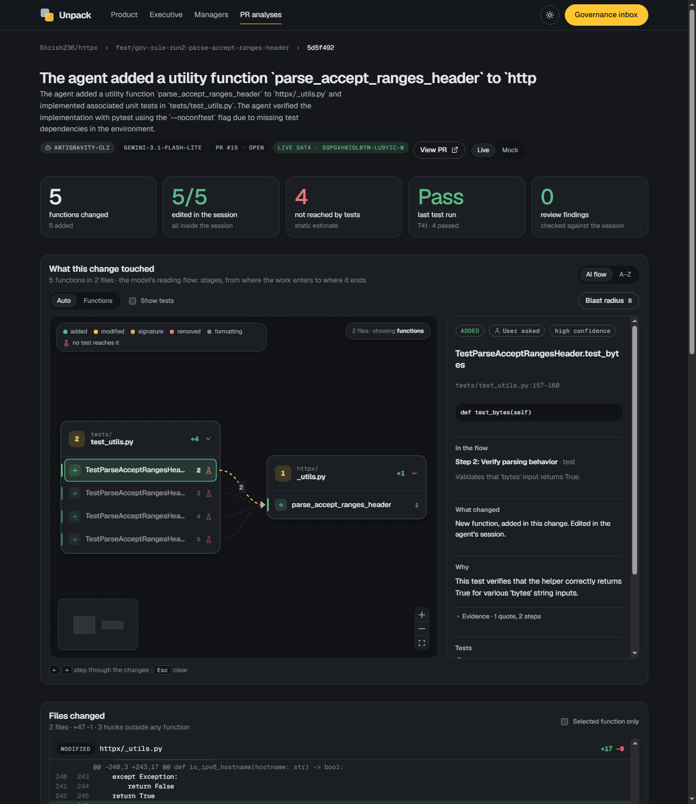
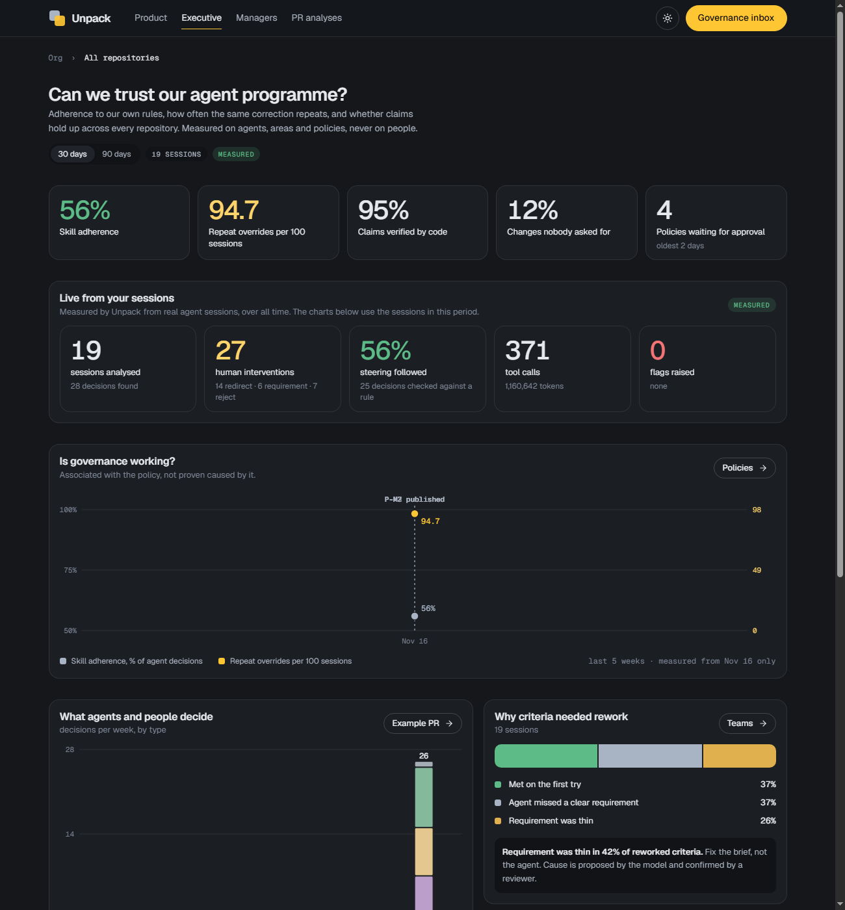
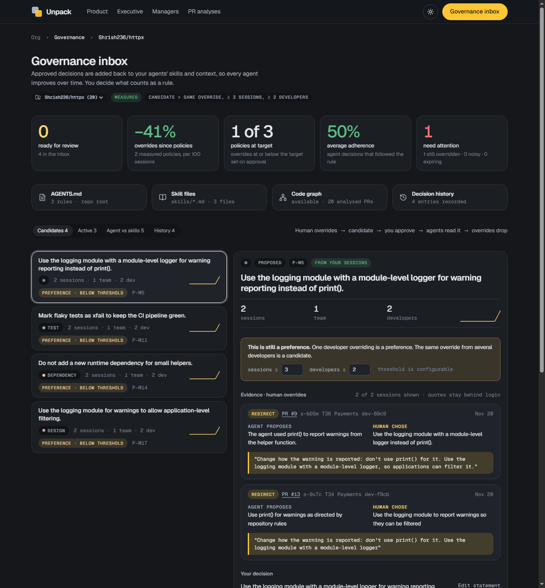
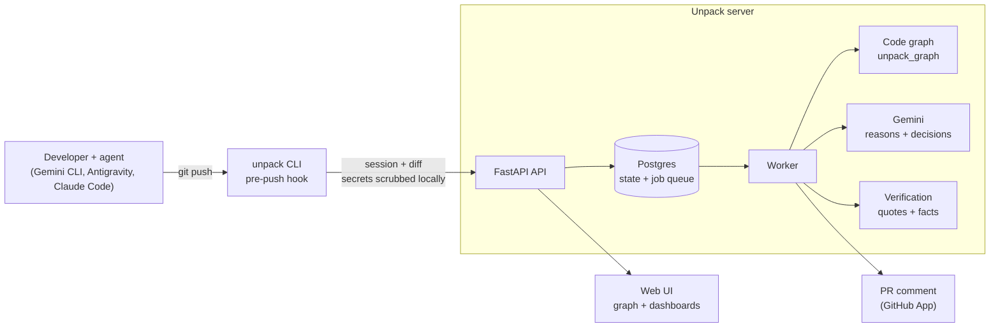

<div align="center">

# Unpack

**Check what an AI coding agent says against what you asked and what actually happened,<br>then turn the verified decisions into governed team knowledge.**

[](https://shrish236.github.io/unpack/)
[](pyproject.toml)
[](web/package.json)

[Live demo](https://shrish236.github.io/unpack/) · [Quickstart](#quickstart) · [How it works](#how-it-works) · [Documentation](docs/README.md)



</div>

---

## Why

AI agents now write pull requests faster than people can read them, and they decide things along the way: which dependency to add, what schema to use, whether to skip a test. Reviewers are left reading the agent's own account of its work.

Unpack works at two levels.

- **For each pull request:** it shows what changed, why, and which changed code no test reaches. Every reason is backed by a verbatim quote from the agent session, and a claim with no quote is dropped.
- **Across pull requests:** it records every decision, by the agent and by the human who corrected it. When the same correction keeps coming back, it proposes a policy that a person approves and that is then checked on later work.

> **AI proposes, evidence decides.** The model extracts and explains. Checks such as "did the tests run", "was there an edit after the last run" and "does a test reach this function" are deterministic, and the model never grades its own claims.

## What you get

| | |
|---|---|
| **Change graph** | Only the changed part of the codebase as an interactive graph, with callers, callees and the blast radius of each change. Edges carry a confidence tier: `EXTRACTED`, `INFERRED` or `AMBIGUOUS`. |
| **Reasons with evidence** | Per function: why it changed, whether you asked for it or the agent decided, and the session turn that shows it. |
| **Test gaps** | Each function is labelled `direct`, `reached`, `reached_uncertain` or `none`. Only `none` is a red flag, and it is checked against a real coverage run. |
| **Decision ledger** | Agent choices and human redirects, rejections and requirements, typed and linked to the code they touched. |
| **Governance inbox** | Repeated human corrections become policy candidates with evidence, a recommendation and an owner. Approved policies are tracked to see whether they work. |
| **Dashboards** | Executive, manager and per-repository views of adherence, repeat overrides and rework. |
| **PR comment** | One comment per pull request, kept up to date, with a summary, risk flags, a graph image and a link to the live page. |

<p align="center">
  
  
</p>

## Live demo

**https://shrish236.github.io/unpack/** is the full dashboard as a read-only static site. It runs on a snapshot of the real database (20 analyses of a fork of `httpx`), so there is no backend and no login. Governance actions are disabled there. See [web/README.md](web/README.md#static-demo-github-pages) for how the snapshot is made.

## How it works



1. **Capture.** On `git push`, the CLI finds the agent session for the branch, removes secrets locally (known values, patterns, high-entropy strings), and sends the session and diff to the server.
2. **Analyse.** The worker builds the code graph at the pushed commit, finds the changed functions, maps each session edit to them, and asks Gemini for the reason and the decisions.
3. **Verify.** Every quote must appear verbatim in the turn it cites, and every claim is checked against the diff and the test runs. Anything that fails is dropped, not shown.
4. **Publish.** The server edits one comment on the pull request and serves the live page.
5. **Aggregate.** Decisions are rolled up into the dashboards and the governance inbox, and measured rows are kept apart from sample data.

## Repository layout

| Path | What it is |
|---|---|
| [`cli/`](cli/README.md) | The `unpack` command: installs the pre-push hook, finds and scrubs the session, uploads it. Adapters for Gemini CLI, Antigravity and Claude Code sessions. |
| [`server/`](server/README.md) | FastAPI API, background worker, branch reconciler, GitHub App integration, LLM pipeline, migrations. |
| [`unpack_graph/`](unpack_graph/README.md) | The code knowledge graph library and the `unpack-graph` CLI (tree-sitter, two-pass resolution, test reachability). |
| [`web/`](web/README.md) | React 19 + TypeScript + Vite UI: PR analysis page, dashboards, governance inbox. |
| [`contract/`](contract/) | JSON Schemas exported from the API models, and fixtures for building the UI without a server. |
| [`deploy/`](deploy/README.md) | Production setup: Compose file, Cloud Run front door, deploy and backup scripts. |
| [`docs/`](docs/README.md) | Design documents, API contract and current status. |
| [`tests/`](tests/) | Graph, CLI and server tests. |

## Quickstart

You need Python 3.11+, Node 20+ and Docker (for Postgres). A Gemini API key is needed only if you want reasoning on real sessions.

```bash
git clone https://github.com/Shrish236/unpack.git
cd unpack

cp .env.example .env            # fill in the secrets; see the comments in the file

docker compose up -d postgres   # Postgres 16
pip install -e ".[dev]"         # or: make install
(cd web && npm install)
```

Run the three processes, each in its own terminal:

```bash
make dev-server    # API on http://localhost:8000
make dev-worker    # job worker and branch reconciler
make dev-ui        # web UI on http://localhost:5173
```

To look around without a real agent session, load sample dashboard data and fake sessions:

```bash
make seed-dashboard
make fake-sessions
```

### Hook up a repository

Register the repository with the server (`POST /admin/repos`, see [docs/api-contract.md](docs/api-contract.md)) to get an ingest token, then in the project you want to analyse:

```bash
unpack install --server "http://localhost:8000" --token "unp_..."
```

From then on every `git push` sends the session and diff. `unpack push --dry-run` shows what would be sent, and `unpack status` shows what the CLI can see. Details are in [cli/README.md](cli/README.md).

### Run the tests

```bash
make test       # pytest -n auto (the server tests need Postgres on localhost:5432)
make lint       # ruff
```

The Neo4j tests are skipped unless a Neo4j service is running.

## Configuration

All settings are environment variables, described in [`.env.example`](.env.example). The server refuses to start if a required secret is missing or too short.

| Variable | Purpose |
|---|---|
| `DATABASE_URL` | Postgres connection string. |
| `UNPACK_BASE_URL` | Public URL, used in PR comments and for OAuth. |
| `GEMINI_API_KEY`, `REASONING_ENABLED` | Turn on the LLM reasoning and decisions passes. |
| `GITHUB_APP_ID`, `GITHUB_APP_PRIVATE_KEY_PATH`, `GITHUB_CLIENT_ID`, `GITHUB_CLIENT_SECRET` | GitHub App: cloning private repositories, viewer login, PR comments. |
| `SESSION_SECRET`, `RENDER_TOKEN_SECRET`, `ADMIN_TOKEN`, `TOKEN_ENCRYPTION_KEY` | Required secrets. Generation commands are in `.env.example`. |
| `PUBLIC_VIEWER`, `DEV_VIEWER_LOGIN` | Demo mode: everyone sees everything as one named viewer, with no GitHub login. Never enable on a server with private data. |

## Deployment

The reference deployment is one VM running [`deploy/docker-compose.prod.yml`](deploy/docker-compose.prod.yml) (API, worker, Postgres), with a small Cloud Run service as the public HTTPS front door. Images are built with Cloud Build ([`cloudbuild.yaml`](cloudbuild.yaml)). See [deploy/README.md](deploy/README.md).

The static demo is published by [`.github/workflows/pages.yml`](.github/workflows/pages.yml) on every push to `main` that touches `web/`.

## Documentation

Start at [docs/README.md](docs/README.md). The most useful pages:

- [Status](docs/status.md): what is built, verified and still open.
- [Server design](docs/server-design.md) and [API contract](docs/api-contract.md).
- [Session pipeline](docs/session-pipeline.md) and [governance pipeline](docs/governance-pipeline.md): how a session becomes reasons, decisions and dashboard numbers.
- [Code graph design](docs/graph-design.md) and [graph API](docs/graph-api.md).
- [UI design](docs/ui-design.md).

## Status and limits

Unpack was built for the Startup Buildathon India 2026 and is under active development.

- The code graph supports **Python only**.
- Session capture supports Gemini CLI and Antigravity sessions directly, and Claude Code through a converter.
- The server builds the graph in memory and caches it on disk. Neo4j is optional and used only by the `unpack-graph` CLI and its tests.
- Reasoning quality has not been validated with outside teams yet.

## Contributing

Issues and pull requests are welcome. Run `make lint` and `make test` before opening a pull request, and keep changes focused. For larger changes, read [docs/status.md](docs/status.md) first so you know which design document is authoritative for the area.

