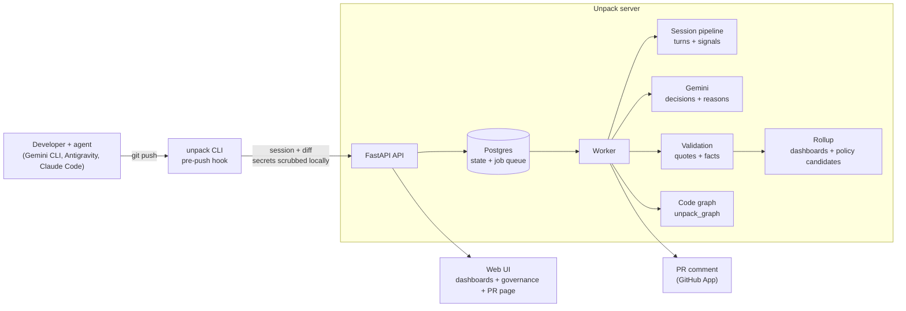

<div align="center">

# Unpack

**Session analysis, response validation and governance for AI coding agents.**

Unpack reads what your agents and your developers actually did, checks every claim against evidence,<br>
and turns repeated human corrections into policies your team approves and tracks.

[](https://shrish236.github.io/unpack/)
[](pyproject.toml)
[](web/package.json)

[Live demo](https://shrish236.github.io/unpack/) · [What Unpack does](#what-unpack-does) · [Quickstart](#quickstart) · [PR analysis](#pr-analysis) · [Documentation](docs/README.md)


</div>

---

## Why

Agents now make engineering decisions all day: which dependency to add, which schema to use, whether to skip a test, whether to follow the team's rules. Nobody records those decisions, compares them across teams, or checks whether the agent's account of its own work is true.

The result is that companies cannot answer basic questions:

- Do our agents follow our own rules, and how often?
- When a developer corrects an agent, does the same correction come back next week?
- Did the agent really do what it said it did, and did it do something nobody asked for?
- Which decisions turned out badly, and did any policy exist for them?

Unpack answers these from evidence. It works in three steps: **analyse** the agent session, **validate** what the agent said, **govern** what happens next.

> **AI proposes, evidence decides.** A model extracts decisions and writes explanations. Everything that can be checked deterministically is checked deterministically (did the tests run, did they pass, was there an edit after the last run, is the claimed change in the diff), and the model never grades its own claims.

## What Unpack does

### 1. Analyse agent sessions

When a developer pushes, the Unpack CLI captures the agent session for that branch (Gemini CLI, Antigravity or Claude Code), scrubs secrets locally and uploads it with the diff. The server then turns the raw transcript into structured, queryable data.

**Turns and signals, with no model involved:**

| Signal | How it is measured |
|---|---|
| Tool use and tokens | Per tool, from the transcript. |
| Refused tool calls | Calls the human cancelled or rejected. |
| Attempts | 1 plus every failing test run that was followed by another edit. |
| Flags | `new-dependency` and `skipped-test` from added lines in manifests and test files and `unsupported` from claims the validator could not back. |
| Test facts | Which tests ran, whether they passed, and whether code changed after the last run. |

**Decisions, extracted by a model and then validated.** One structured model call per push produces a ledger of decisions, each with a type and a verbatim quote from the session.

- **Human decisions:** `redirect` (change course), `reject` (refuse a proposal), `requirement` (state a constraint) and `discussion`. Each carries a short, reusable **statement**: the correction rewritten as a rule. That is what lets the same correction made in different sessions be recognised as one thing.
- **Agent decisions:** `choice`, with the steering rule that applied and whether the agent followed it.
- **Highlights:** what went right and what went wrong in the session.
- **Decision types:** new dependency, data model, auth and security, error handling and retries, API contract, test strategy (including skipping or deleting tests), config and infrastructure, and scope.

**Steering rules.** Unpack reads the steering files in the repository at the pushed commit (the rules files you give your agents) and splits them into individual rules. Each agent decision that touches a rule is recorded as followed or violated, so adherence is measured per rule.

### 2. Validate what the agent says

An agent's own narration is self-authored evidence, so Unpack does not trust it. Every output of the model goes through verification before it is stored or shown:

- **Quotes must be verbatim.** A decision's quote has to appear word for word in the turn it cites. No quote, no claim.
- **Turns must match roles.** A human decision must sit on a user turn and an agent decision on an agent turn.
- **Rules must exist.** A cited steering rule has to be in the snapshot of the repository.
- **Claims are checked against facts.** "All tests pass" is compared with the actual test runs. "I only changed X" is compared with the diff. A claim that is not backed becomes an `unsupported` flag instead of being believed.
- **User intent is anchored on the user's turns.** The agent's stated rationale is shown as such, not as ground truth.

Anything that fails verification is dropped and counted (`decisions_rejected`), so you can see how much of a model's output was thrown away. If the governance pass breaks, the analysis still completes and records why.

### 3. Govern the agent programme

Validated decisions are stored permanently and rolled up across sessions, repositories and time.

**Policy candidates.** Human corrections with a statement are grouped by type and wording. When the same correction shows up in enough separate sessions (two by default), it becomes a candidate with the real quotes as evidence.

**A decision brief for each candidate**, so a reviewer decides on more than a pile of quotes:

- how many sessions, teams and developers raised it, and how often the agent proposed the thing in the first place
- which areas of the code it affects
- the rework it caused (turns, hours, pull requests)
- how far it reaches if made policy (repositories, teams, pull requests that would have been flagged)
- overlap or conflict with existing policies
- a recommendation: approve, trial, or wait, with a suggested enforcement level

**The governance inbox.** A person approves a candidate with a scope (repository, team or organisation), an enforcement level (`advice`, `check` or `gate`), an owner, an expiry and a target. They can also reject it with a reason, or watch it until more evidence arrives. Active policies can be renewed, revised, relaxed or retired.

**Did the policy work?** Approved policies are tracked: adherence, overrides per 100 sessions before and after approval, and how many checks flagged a pull request and how many a reviewer then overruled as wrong. A policy that does not reduce repeat corrections is visible as such.

**Dashboards for three audiences:**

| Page | Question it answers |
|---|---|
| Executive | Can we trust our agent programme? Skill adherence, repeat overrides per 100 sessions, claims verified by code, changes nobody asked for, and the policy approval backlog. |
| Managers | How are our teams and repositories doing? Where is rework concentrated, whether the requirement or the agent was the cause, and which suggestions to act on. |
| Governance inbox | What should we make policy? Candidates, active policies, rules, and history. |

Measured numbers come from real sessions and are kept apart from sample baseline data, with a label on each section.

<p align="center">
  
</p>

## Live demo

**https://shrish236.github.io/unpack/** is the full dashboard as a read-only static site. It runs on a snapshot of real data (20 analysed pushes to a fork of `httpx`), with no backend and no login. Governance actions are disabled there. See [web/README.md](web/README.md#static-demo-github-pages) for how the snapshot is made.

## How it works



1. **Capture.** On `git push`, the CLI finds the agent session, removes secrets locally (known values, token patterns, high-entropy strings), and uploads the session and diff.
2. **Analyse.** The worker parses the session into turns, computes signals, reads the steering rules, and asks the model for decisions and reasons.
3. **Validate.** Quotes, roles, rules and claims are checked. Anything that fails is dropped.
4. **Roll up.** Decisions feed the dashboards and the policy candidates. The rollup is idempotent and never touches sample rows.
5. **Publish.** The server serves the web UI and keeps one comment per pull request up to date.

## Security and privacy

- **Secrets never leave the developer's machine.** The CLI scrubs `.env` values, known token patterns (GitHub, AWS, Google, OpenAI, Anthropic, Slack, Stripe and others), private keys and high-entropy strings before upload.
- **The hook never blocks a push.** If anything fails, the push proceeds and the failure is printed.
- **Per-repository ingest tokens.** Uploads are authenticated with a bearer token scoped to one repository.
- **Viewer access follows GitHub.** Viewers log in with GitHub and see only repositories they can access. Their tokens are stored encrypted.
- **Self-hostable.** The whole stack (API, worker, Postgres) runs on one machine you control, and the model provider is configurable.

Never commit a real `.env`, a GitHub App private key or an API key. `.env` and `*.pem` are git-ignored, and the example env files contain placeholders only.

## Quickstart

You need Python 3.11+, Node 20+ and Docker (for Postgres). A Gemini API key is needed only to run the model passes on real sessions.

```bash
git clone https://github.com/Shrish236/unpack.git
cd unpack

cp .env.example .env            # fill in the secrets; see the comments in the file

docker compose up -d postgres   # Postgres 16
pip install -e ".[dev]"         # or: make install
(cd web && npm install)
```

Run the three processes, each in its own terminal:

```bash
make dev-server    # API on http://localhost:8000
make dev-worker    # job worker and branch reconciler
make dev-ui        # web UI on http://localhost:5173
```

To explore the dashboards without a real agent session, load sample data:

```bash
make seed-dashboard
make fake-sessions
```

### Hook up a repository

Register the repository with the server (`POST /admin/repos`, see [docs/api-contract.md](docs/api-contract.md)) to get an ingest token, then in the project you want to analyse:

```bash
unpack install --server "http://localhost:8000" --token "<your-ingest-token>"
```

From then on every `git push` sends the session and diff. `unpack push --dry-run` shows what would be sent and `unpack status` shows what the CLI can see. See [cli/README.md](cli/README.md).

### Run the tests

```bash
make test       # pytest -n auto (the server tests need Postgres on localhost:5432)
make lint       # ruff
```

The model is replaced by a mock in the tests, so no API key is needed. The Neo4j tests are skipped unless a Neo4j service is running.

## Configuration

All settings are environment variables, described in [`.env.example`](.env.example). The server refuses to start if a required secret is missing or too short.

| Variable | Purpose |
|---|---|
| `DATABASE_URL` | Postgres connection string. |
| `UNPACK_BASE_URL` | Public URL, used in PR comments and for OAuth. |
| `GEMINI_API_KEY`, `REASONING_ENABLED` | Turn on the model passes (decisions and reasons). |
| `GITHUB_APP_ID`, `GITHUB_APP_PRIVATE_KEY_PATH`, `GITHUB_CLIENT_ID`, `GITHUB_CLIENT_SECRET` | GitHub App: cloning private repositories, viewer login, PR comments. |
| `SESSION_SECRET`, `RENDER_TOKEN_SECRET`, `ADMIN_TOKEN`, `TOKEN_ENCRYPTION_KEY` | Required secrets. Generation commands are in `.env.example`. |
| `CANDIDATE_MIN_SESSIONS` | Sessions needed before a repeated correction becomes a policy candidate (default 2). |
| `PUBLIC_VIEWER`, `DEV_VIEWER_LOGIN` | Demo mode: everyone sees everything as one named viewer, with no login. Never enable on a server that holds private data. |

## Deployment

The reference deployment is one VM running [`deploy/docker-compose.prod.yml`](deploy/docker-compose.prod.yml) (API, worker, Postgres), with a small Cloud Run service as the public HTTPS front door. Images are built with Cloud Build ([`cloudbuild.yaml`](cloudbuild.yaml)). See [deploy/README.md](deploy/README.md).

The static demo is published by [`.github/workflows/pages.yml`](.github/workflows/pages.yml) on every push to `main` that touches `web/`.

## PR analysis

Alongside governance, Unpack explains each individual pull request, so a reviewer can understand agent-written code without reading the diff line by line. Every reason comes from the same validated session data described above.

<p align="center">
  
</p>

- **Change graph.** Only the changed part of the codebase, as an interactive graph with callers, callees and the blast radius of each change. Every edge carries a confidence tier: `EXTRACTED`, `INFERRED` or `AMBIGUOUS`.
- **Reasons with evidence.** For each changed function: why it changed, whether the user asked for it or the agent decided, and the session turn that shows it.
- **Test gaps.** Each function is labelled `direct`, `reached`, `reached_uncertain` or `none`. Only `none` is a red flag, and it is checked against a real coverage run.
- **Reading flow, file diff and timeline.** The change in a sensible order, the diff grouped by function, and the session timeline beside it.
- **Decisions on the page.** The governance decisions made in that session, linked to the functions they touched.
- **PR comment.** One comment per pull request, kept up to date, with a summary, risk flags, a graph image and a link to the live page.

The code graph is built by [`unpack_graph/`](unpack_graph/README.md), a tree-sitter based library that also ships its own `unpack-graph` CLI. It supports Python only.

## Repository layout

| Path | What it is |
|---|---|
| [`cli/`](cli/README.md) | The `unpack` command: installs the pre-push hook, finds and scrubs the session, uploads it. Adapters for Gemini CLI, Antigravity and Claude Code sessions. |
| [`server/`](server/README.md) | FastAPI API, background worker, session and governance pipelines, GitHub App integration, migrations. |
| [`unpack_graph/`](unpack_graph/README.md) | The code knowledge graph library behind PR analysis. |
| [`web/`](web/README.md) | React 19 + TypeScript + Vite UI: dashboards, governance inbox, PR analysis page. |
| [`contract/`](contract/) | JSON Schemas exported from the API models, and fixtures for building the UI without a server. |
| [`deploy/`](deploy/README.md) | Production setup: Compose file, Cloud Run front door, deploy and backup scripts. |
| [`docs/`](docs/README.md) | Design documents, API contract and current status. |
| [`tests/`](tests/) | Graph, CLI and server tests. |

## Documentation

Start at [docs/README.md](docs/README.md). The most useful pages:

- [Governance pipeline](docs/governance-pipeline.md): how a session becomes decisions, policy candidates and dashboard numbers.
- [Session pipeline](docs/session-pipeline.md): how a transcript becomes turns, reasons and verified evidence.
- [Server design](docs/server-design.md) and [API contract](docs/api-contract.md).
- [Status](docs/status.md): what was built and verified at a point in time.
- [Code graph design](docs/graph-design.md), [graph API](docs/graph-api.md) and [UI design](docs/ui-design.md).

## Status and limits

Unpack was built for the Startup Buildathon India 2026 and is under active development.

- The code graph, and so PR analysis, supports **Python only**. Session capture and governance do not depend on the language.
- Session capture supports Gemini CLI and Antigravity sessions directly, and Claude Code through a converter.
- Policy enforcement levels (`advice`, `check`, `gate`) are recorded and tracked. Reasoning quality has not yet been validated with outside teams.
- The server builds graphs in memory and caches them on disk. Neo4j is optional and used only by the `unpack-graph` CLI and its tests.

## Contributing

Issues and pull requests are welcome. Run `make lint` and `make test` before opening a pull request, and keep changes focused. For larger changes, read [docs/status.md](docs/status.md) first so you know which design document is authoritative for the area.
